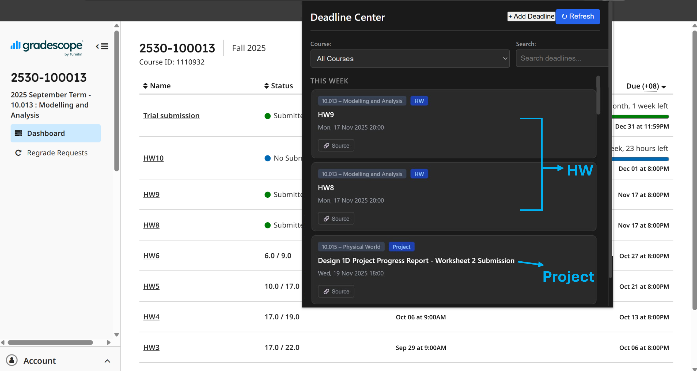
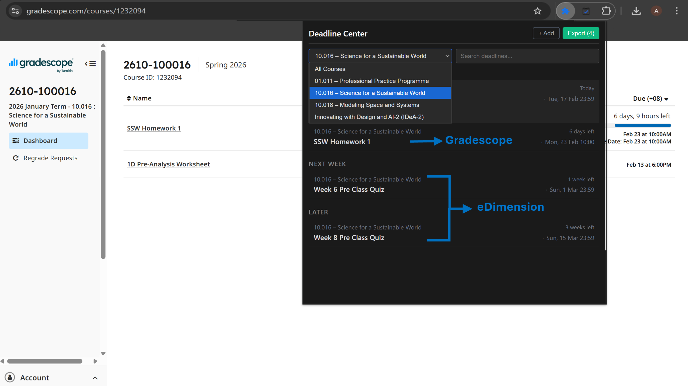
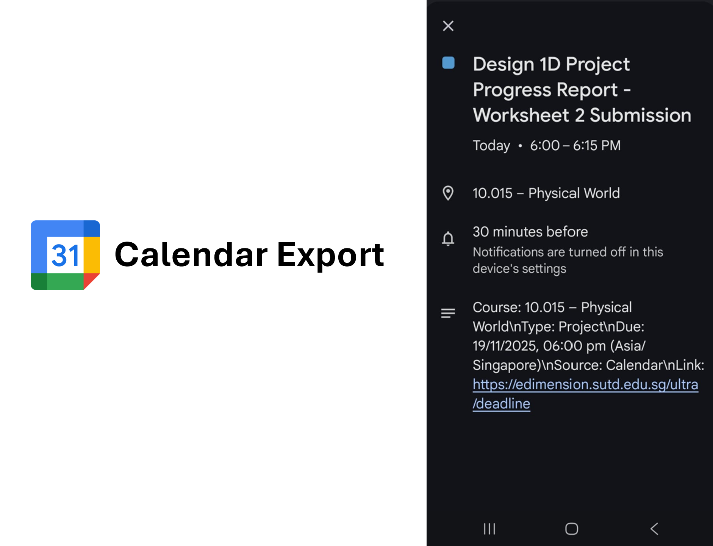

# SUTD Deadline Center
Pulls your deadlines from eDimension and Gradescope into one list. Export to Google, Apple or Outlook Calendar as an `.ics` file.

[](https://chromewebstore.google.com/detail/sutd-deadline-center/didnpjogdamalaggfnidojaoconlobpk)

# Install
- Chrome, Edge, Brave or Arc: [Chrome Web Store](https://chromewebstore.google.com/detail/sutd-deadline-center/didnpjogdamalaggfnidojaoconlobpk)
- Firefox: [Firefox Add-ons](https://addons.mozilla.org/firefox/addon/sutd-deadline-center/)

# Features
- Auto-extracts deadlines when you visit eDimension or Gradescope
- Filter by course or cohort tags (e.g., "04" for SC04)
- Click any deadline to jump back to the source assignment
- Add custom deadlines manually

# Screenshots

<sup>eDimension deadlines, grouped by week</sup>


<sup>One course, with deadlines from Gradescope and eDimension</sup>


<sup>An exported deadline in Google Calendar</sup>

# Privacy
Your deadlines stay in your browser and nothing is sent anywhere. It only saves each deadline's course, name and due date, never your grades or password.

# Build it yourself
```bash
npm ci
npm run build          # Chrome, outputs dist/
npm run build:firefox  # Firefox, outputs dist-firefox/
```

- Chrome: open `chrome://extensions`, turn on Developer mode, click Load unpacked and pick `dist/`
- Firefox: open `about:debugging#/runtime/this-firefox`, click Load Temporary Add-on and pick `dist-firefox/manifest.json`

# Issues
Missing or wrong deadline? [Open an issue](https://github.com/AbhishekVulla/sutd-deadline-center/issues).
